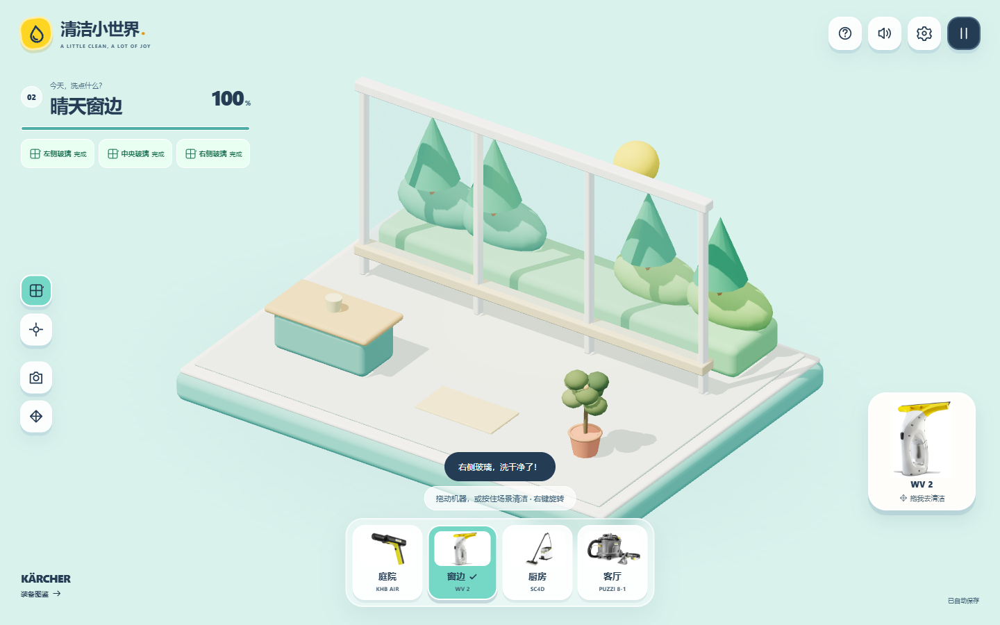
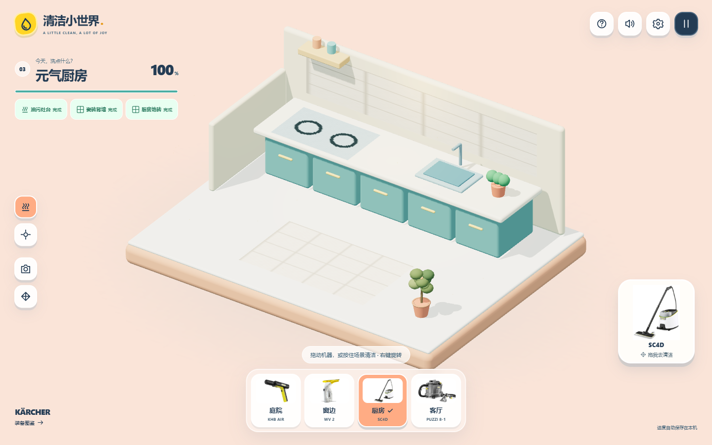
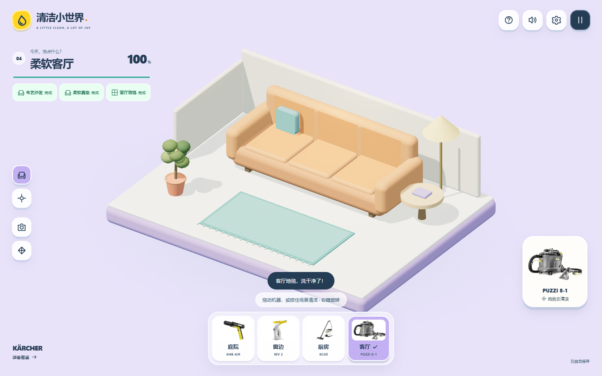
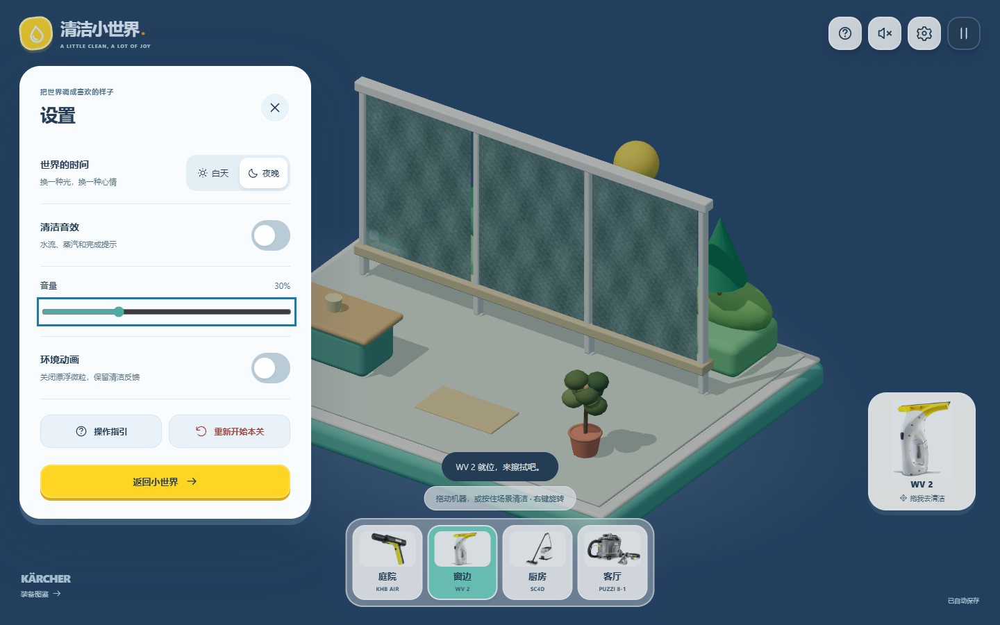

# 清洁小世界 · Clean a Little

[](LICENSE)

**拖动一台机器，洗亮一个小世界。**

一个基于 TypeScript、Three.js 和 Vite 的浏览器 3D 清洁游戏。在庭院、窗边、厨房和客厅里，用四款卡赫设备清除污渍，观察原色和风景逐渐显现。没有倒计时、体力或购买限制，打开网页即可开始。

**[在线试玩](https://clean-a-little.vercel.app/) · [快速开始](#快速开始) · [操作说明](#操作说明) · [项目文档](#项目文档) · [许可证](#许可证)**


## 玩法与特性

- **四个完整场景**：每关有三个独立任务、进度、完成反馈和重玩入口，可随时切换。
- **拖动设备清洁**：支持鼠标、触屏和键盘，也可以直接按住场景清洁。
- **真实局部污渍**：清洁发生在三维表面命中的位置；反复擦过干净区域不会重复增加进度。
- **四种清洁反馈**：水流冲洗、扁平擦窗、蒸汽与布艺喷抽，配合粒子和程序合成音效。
- **轻松收尾**：每项任务达到 92% 后自动清除少量余渍，三项完成后结算并可前往下一站。
- **本机自动保存**：四关独立保存清洁痕迹与用时，刷新恢复当前场景；重玩只重置当前关。
- **可调的小世界**：昼夜、音效、音量和环境动画设置会保存，支持系统减少动画偏好。

## 四个可玩场景

| 场景 | 清洁设备 | 小任务与变化 |
| --- | --- | --- |
| 庭院日常 | KHB AIR 无线折叠清洗机 | 冲洗单车、长椅和地砖，找回原本的颜色 |
| 晴天窗边 | WV 2 镜面清洁机 | 擦亮左、中、右三块玻璃，露出窗后的三维花园 |
| 元气厨房 | SC4D 多功能蒸汽清洁机 | 清洁油污灶台、瓷砖背墙和厨房地面 |
| 柔软客厅 | PUZZI 8-1 布艺喷抽机 | 清洁沙发、靠垫和地毯，恢复织物色彩 |

底部选择器可直接进入对应场景，装备图鉴可查看设备与 KHB AIR 的展开 / 折叠状态。厂商设备使用用户提供的产品照片，场景由程序化三维几何构建；清洁参数属于游戏设定。

<details>
<summary>展开更多场景与设置截图</summary>

| 晴天窗边 · 清洁后 | 元气厨房 · 清洁后 |
| --- | --- |
|  |  |
| **柔软客厅 · 清洁后** | **设置与夜间模式** |
|  |  |

更多前后对比见 [验收记录](docs/verification.md)。

</details>

## 快速开始

### 环境要求

- Node.js **22.14 或更高版本**，以及 npm。
- 支持 WebGL 2 的浏览器；浏览器自动化验收使用本机 Chrome。
- 普通开发直接使用仓库中的 WebP 图片，无需原始素材或 Python。

```bash
git clone https://github.com/dandan1232/WaytoAGI-games.git
cd WaytoAGI-games
npm ci
npm run dev
```

打开终端显示的本地地址，默认是 `http://127.0.0.1:5173`，点击“开始清洁”。项目为静态前端，无需配置后端、数据库、API 密钥或环境变量；运行时的场景、照片与音效不依赖第三方 CDN。

在 Windows PowerShell 中向 npm 脚本传递额外参数时，使用 `npm.cmd`。例如需要通过局域网设备访问时：

```powershell
npm.cmd run dev -- --host 0.0.0.0
```

## 操作说明

| 操作 | 鼠标 / 键盘 | 触屏 |
| --- | --- | --- |
| 拖动机器清洁 | 按住机器，拖过污渍 | 单指拖动机器 |
| 直接清洁 | 按住场景左键拖动 | 单指按住场景拖动 |
| 旋转视角 | 右键拖动 | 双指拖动 |
| 缩放视角 | 滚轮 | 双指缩放 |
| 键盘移动机器 | 聚焦机器后按方向键，Shift 加速；按住空格清洁 | — |
| 宽幅 / 细节清洁 | 边缘工具或数字键 1 / 2 | 边缘工具 |
| 聚焦清洁目标 | 点击任务按钮 | 点击任务按钮 |
| 复位视角 | 相机按钮或 R | 相机按钮 |
| 收回机器 | 四向箭头按钮 | 四向箭头按钮 |
| 音效开关 | 扬声器按钮或 M | 扬声器按钮 |
| 设置 / 暂停 | 右上设置 / 暂停按钮，Esc 暂停或关闭面板 | 右上按钮 |

松开指针、取消触摸、切换场景、打开面板或窗口失焦时会停止清洁。存档按浏览器和网站来源区分，本地与线上进度分别保存；图片或本地存储不可用时仍可游玩。

## 开发与验证

| 命令 | 用途 |
| --- | --- |
| `npm run dev` | 启动本地开发服务器 |
| `npm run check` | TypeScript 类型检查 |
| `npm test` | 清洁算法、存档、关卡、设置与拖动边界测试 |
| `npm run build` | 类型检查并生成 `dist/` 生产产物 |
| `npm run preview` | 本地预览生产产物，需先构建 |
| `npm run test:e2e` | 串行执行 Chrome 真实鼠标 / 触屏验收 |
| `npm run test:production` | 构建并验证独立生产预览中的四关交互 |

浏览器测试需要 Chrome。未安装时运行：

```bash
npx playwright install chrome
```

2026-10-25 的功能验收记录为 **26 项逻辑测试、14 项浏览器验收及线上复验通过**。四关完整通关均通过真实指针输入完成。详细覆盖、截图和限制见 [验收记录](docs/verification.md)。请统一运行 `npm run test:e2e`，避免多组 Playwright 进程共用 `test-results/` 报告目录。

复验已部署的网站：

```bash
node scripts/verify-production.mjs https://clean-a-little.vercel.app/
```

手机已通过浏览器触屏模拟验证，尚未完成 iOS / Android 真机性能评审。产品照片不是可旋转的工业设计模型，游戏反馈不代表真实设备性能。

## 项目结构

```text
src/
  core/                 污渍网格、关卡定义、存档、偏好与拖动边界
  game/                 Three.js 场景、材质、输入协调、特效与音频
  ui/                   界面、设备图鉴、拖动工具与图标
  main.ts               页面入口与 WebGL 降级
  styles.css            响应式布局与昼夜样式
public/
  products/             已压缩的厂商产品图片
scripts/
  prepare-product-assets.py  离线转换原始产品图片
  verify-production.mjs     本地 / 线上生产验收
tests/                  纯逻辑测试
e2e/                    浏览器交互与通关验收
docs/                   需求、架构、设计、部署与截图
LICENSE                 项目 MIT 许可证
THIRD_PARTY_NOTICES.md   第三方素材、商标与依赖说明
```

`images/` 是仅保留在本地的原始厂商素材目录，不随仓库分发。仅在重新生成网页图片时需要 Python 3 + Pillow 和原图，具体操作见 [素材说明](docs/product-assets.md)。依赖版本由 `package-lock.json` 固定。

## 部署

项目已部署到 Vercel，仓库 `main` 的推送会触发自动更新。其他静态托管平台也可使用 `dist/` 作为部署产物。

| 配置 | 值 |
| --- | --- |
| Framework | Vite |
| Install Command | `npm ci` |
| Build Command | `npm run build` |
| Output Directory | `dist` |
| 后端 / 环境变量 | 无需配置 |

现有项目关联、缓存策略、部署命令与线上验证记录见 [Vercel 部署说明](docs/deployment.md)。

## 项目文档

- [需求与验收标准](docs/requirements.md)
- [四场景与 UI 设计](docs/design-v2.md)
- [架构与清洁算法](docs/architecture.md)
- [开发与提交里程碑](docs/development.md)
- [厂商设备素材](docs/product-assets.md)
- [验收记录和截图](docs/verification.md)
- [Vercel 部署](docs/deployment.md)
- [初版技术决策](docs/decisions/0001-browser-prototype.md)

## 贡献

欢迎通过 Issue 反馈问题、提出场景创意，或提交 Pull Request。

1. 描述修改的行为和复现方式，界面改动附上截图。
2. 提交前运行 `npm run check`、`npm test` 和 `npm run build`；涉及交互、场景或存档时运行对应浏览器验收。
3. 行为变化同步更新相关文档，新增素材说明其来源与许可。
4. 保留第三方版权声明，不提交原始厂商素材、凭据、依赖目录或临时产物。

## 来源与致谢

- 创意方向来自 [德国卡赫创意 brief](https://ocn8hd90aveq.feishu.cn/wiki/RRdmwGT1kiBXvRkfRa5c0ydCnAb)。
- 界面布局与玩具感参考 [Choo-Choo World](https://choochooworld.com/?DATA=DFFBHFIJB/0/D)；场景几何、交互和界面由本项目实现。
- 感谢 Three.js、Vite、TypeScript、Vitest、Playwright 等开源项目。

## 许可证

项目原创代码与文档采用 **[MIT License](LICENSE)**。

厂商产品照片、第三方商标，以及截图中对应的第三方图像与标识不由本项目授予 MIT 许可。依赖继续适用各自的许可证。素材范围、依赖许可和 Three.js 版权声明见 [第三方声明](THIRD_PARTY_NOTICES.md)。
