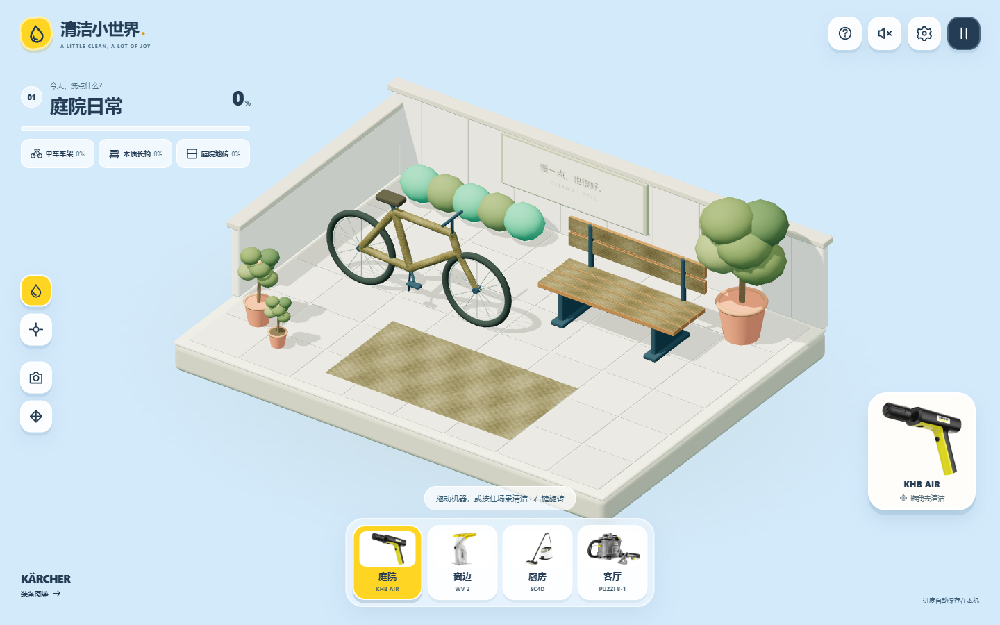

# 清洁一平方米 · Clean a Little

根据德国卡赫创意 brief 制作的 3D 清洁互动原型。在一座微缩庭院里，洗净单车、长椅和地砖，让日常空间重新焕发色彩。

**[在线试玩 → clean-a-little.vercel.app](https://clean-a-little.vercel.app)**

支持本地运行和 Vercel 托管，游戏逻辑与存档均在浏览器中完成。



## 项目文档

- [需求与验收标准](docs/requirements.md)
- [架构与清洁算法](docs/architecture.md)
- [开发、验证与里程碑](docs/development.md)
- [技术决策记录](docs/decisions/0001-browser-prototype.md)
- [浏览器验收与已知限制](docs/verification.md)
- [Vercel 部署说明](docs/deployment.md)

## 本地开发

需要 Node.js 22.14+ 与 npm。

```powershell
npm ci
npm run dev
```

打开终端显示的本地地址（默认 `http://127.0.0.1:5173`），点击“开始清洁”。运行时无需外部模型、图片、字体或 CDN。

```powershell
npm test          # 清洁与存档逻辑
npm run check    # TypeScript
npm run build    # 类型检查与生产构建
npm run preview  # 预览生产构建
npm run test:e2e # Chrome 浏览器交互验收
npm run test:production # 构建并验证生产版本
```

## 第一版范围

- 一个可旋转查看的 3D 庭院，包含三个清洁目标。
- 按住鼠标或触屏拖动清洗；切换清洗范围，观察真实的局部污渍消退。
- 分目标进度、音效、水流反馈和完成展示。
- 本地保存进度、继续体验和重新开始。

## 操作

| 操作 | 鼠标 / 键盘 | 触屏 |
| --- | --- | --- |
| 清洗 | 按住左键拖动 | 单指按住拖动 |
| 旋转庭院 | 按住右键拖动 | 双指拖动 |
| 缩放 | 滚轮 | 双指缩放 |
| 切换喷幅 | 底部按钮或 1 / 2 | 底部按钮 |
| 复位视角 | 相机按钮或 R | 相机按钮 |
| 音效 | 右上按钮或 M | 右上按钮 |
| 暂停 | 右上按钮或 Esc | 右上按钮 |

点击右侧任务可聚焦目标；每项清洗达到 92% 后会自动清除少量余渍。三项完成后展示结算，可欣赏庭院或重玩。暂停和刷新会保存当前表面的实际清洗痕迹；存储被浏览器禁用时仍可游玩。

浏览器验收默认使用已安装的 Chrome。没有 Chrome 时先运行 `npx playwright install chrome`，或调整 `playwright.config.ts` 的浏览器通道。Windows PowerShell 里向 npm 脚本传递额外参数时，可使用 `npm.cmd`；例如 `npm.cmd run dev -- --host 0.0.0.0`。

当前是本地单关原型，示意设备和喷幅数值用于游戏交互，不代表真实产品参数。活动是否接受游戏投稿仍需确认。
