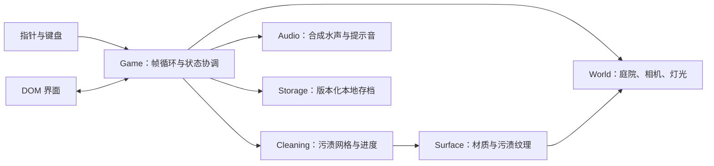

# 架构文档

日期：2026-10-24。本文记录首版设计，交付后按实际实现更新。

## 1. 技术选择

TypeScript + Vite + Three.js，浏览器本地运行，无服务端。DOM / CSS 负责界面，Three.js 负责场景、相机、射线和粒子。纯 TypeScript 模块管理清洁与存档，使用 Vitest 测试；Playwright 用于浏览器验收。

不引入组件框架和物理引擎：首版是单场景，界面状态与场景模型均较小。避免以搭建平台替代核心手感。

## 2. 模块边界



预期目录：

```text
src/
  main.ts              页面入口、降级与生命周期
  styles.css           响应式界面
  game/
    game.ts            输入、清洗和 UI 的协调
    world.ts           程序化庭院、可清洗表面注册
    surface.ts         污渍纹理、材质和命中映射
    effects.ts         水流与粒子
    audio.ts           Web Audio，用户交互后初始化
  core/
    cleaning.ts        无渲染依赖的污渍网格、笔刷、完成阈值
    save.ts            存档编码、校验、读取与安全写入
  ui/
    interface.ts       HUD、对话框、任务与操作绑定
tests/                 核心逻辑测试
e2e/                   浏览器交互验收
docs/                  需求、架构、决策和验收记录
```

## 3. 清洁数据与渲染

每个可清洁表面拥有独立污渍网格，网格单元表示剩余污渍量。渲染纹理由网格生成；命中点映射到网格局部坐标，应用有边缘衰减的笔刷。清洁变化量受 `deltaTime` 限制，重复清洗已清理处不增加进度。

清洗面积应使用世界空间半径换算，避免大小物件的操作手感完全不同。平面按自身宽高映射；管状几何使用自身 UV 和尺寸映射。纹理分辨率按表面尺寸选择并设置上限。

任务进度由各表面的有效污垢面积加权，不能简单平均每块网格的百分比。任务达到 92% 后自动清理余量、触发一次完成事件。总进度按任务面积汇总，三项完成后结算。

可清洁材质保留本色与粗糙度，以污渍网格遮罩混合泥污颜色。清洁效果发生在真实三维表面，不能用屏幕上的透明擦除层冒充。

## 4. 射线与输入

屏幕坐标换算 NDC，再从相机投射射线。选取场景中最近的可遮挡表面；最近表面不可清洁时不能穿透清洗后面的目标。

左键 / 单指清洗，右键 / 双指交给 OrbitControls。输入捕获到 canvas，监听 pointercancel、blur 和 visibilitychange，保证离开窗口后不会持续喷水。清洗与旋转模式互斥。

交互射线与水花使用相同命中点。背景指针移动只更新准星，不修改污渍数据。

## 5. 状态与持久化

游戏阶段：引导 / 游玩 / 暂停 / 完成。界面只通过明确回调切换阶段。

`localStorage` 保存版本号、关卡标识、每块表面的污渍数据、用时和音效偏好。存档限制大小，校验数值范围、目标标识和网格尺寸。未知版本 / 损坏存档回退为新关卡，保存异常不影响运行。

只在进度变化后节流保存，同时在任务完成、暂停和页面隐藏时保存。先加载有效存档再初始化 HUD。重玩重建污渍并清空用时，不沿用已完成面板。

## 6. 性能与资源

程序化几何和本地依赖打包，不加载外部模型或图片。共享静态材质与几何，固定粒子池，限制 DPR 至 2，使用低分辨率污渍纹理与阴影。

可隐藏的页面暂停清洗和音频；动画 `deltaTime` 截断。renderer、纹理、几何、事件监听和 AudioContext 均应有释放路径。WebGL 初始化失败时用 DOM 给出重试信息。

## 7. 验证策略

纯算法测试：局部修改、重复清洗、边界笔刷、面积权重、完成阈值、存档往返、损坏数据和未知版本。

浏览器验收：真实射线清洗、对空喷射无进度、任务与总进度、刷新恢复、暂停停止、重玩取消 / 确认、结算、移动端布局和 WebGL 控制台错误。

程序化场景测试可以读取开发构建的只读测试信息，避免向最终产品界面暴露调试操作。完整完成流程应通过输入清洗达成，不能只改 UI 计数。
