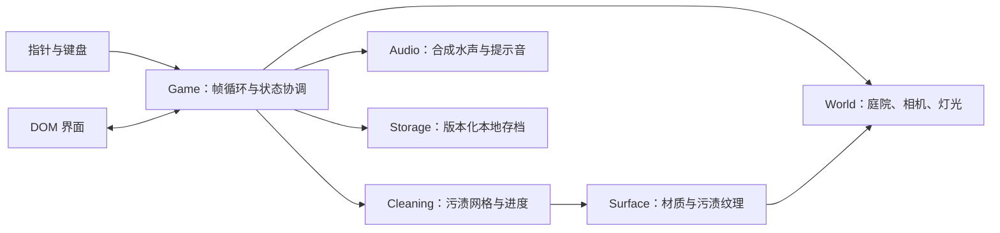

# 架构文档

日期：2026-10-24。本文已按首版实现更新。

## 1. 技术选择

TypeScript + Vite + Three.js，浏览器本地运行，无服务端。DOM / CSS 负责界面，Three.js 负责场景、相机、射线和粒子。纯 TypeScript 模块管理清洁与存档，使用 Vitest 测试；Playwright 用于浏览器验收。

不引入组件框架和物理引擎：首版是单场景，界面状态与场景模型均较小。避免以搭建平台替代核心手感。

## 2. 模块边界



预期目录：

```text
src/
  main.ts              页面入口、降级与生命周期
  styles.css           响应式界面
  game/
    game.ts            输入、清洗和 UI 的协调
    world.ts           程序化庭院、可清洗表面注册
    surface.ts         污渍纹理、材质和命中映射
    effects.ts         水流与粒子
    audio.ts           Web Audio，用户交互后初始化
  core/
    cleaning.ts        无渲染依赖的污渍网格、笔刷、完成阈值
    save.ts            存档编码、校验、读取与安全写入
  ui/
    interface.ts       HUD、对话框、任务与操作绑定
tests/                 核心逻辑测试
e2e/                   浏览器交互验收
docs/                  需求、架构、决策和验收记录
```

## 3. 清洁数据与渲染

每个可清洁表面拥有独立污渍网格，网格单元表示剩余污渍量。渲染纹理由网格生成；命中点映射到网格局部坐标，应用有边缘衰减的笔刷。清洁变化量受 `deltaTime` 限制，重复清洗已清理处不增加进度。

清洗面积应使用世界空间半径换算，避免大小物件的操作手感完全不同。平面按自身宽高映射；管状几何使用自身 UV 和尺寸映射。纹理分辨率按表面尺寸选择并设置上限。

任务进度由各表面的有效污垢面积加权，不能简单平均每块网格的百分比。任务达到 92% 后自动清理余量、触发一次完成事件。总进度按任务面积汇总，三项完成后结算。

可清洁材质保留本色与粗糙度，以污渍网格遮罩混合泥污颜色。清洁效果发生在真实三维表面，不能用屏幕上的透明擦除层冒充。

实际采用 CPU 更新的 `CanvasTexture`：将程序化本色纹理与污渍颜色按网格数值逐像素混合，再上传给 `MeshStandardMaterial`。这样保留标准光照和阴影，也避开依赖 Three.js 内部 shader chunk 的补丁。首关共 14 个可清洁表面：7 段车架管、4 块座板、2 块靠背、1 片地砖，总计 16,128 个污渍单元。

车架细管周向采用包裹式笔刷，只沿管轴要求玩家移动，减少背面细小区域难以触达的问题；不会清洗其他被遮挡的物件。长椅只把可见木板的上表面 / 正面注册为任务，背面保持原始干净材质。

## 4. 射线与输入

屏幕坐标换算 NDC，再从相机投射射线。选取场景中最近的可遮挡表面；最近表面不可清洁时不能穿透清洗后面的目标。

左键 / 单指清洗，右键 / 双指交给 OrbitControls。输入捕获到 canvas，监听 pointercancel、blur 和 visibilitychange，保证离开窗口后不会持续喷水。清洗与旋转模式互斥。

交互射线与水花使用相同命中点。背景指针移动只更新准星，不修改污渍数据。

## 5. 状态与持久化

游戏阶段：引导 / 游玩 / 暂停 / 完成。界面只通过明确回调切换阶段。

`localStorage` 保存版本号、关卡标识、每块表面的污渍数据、用时和音效偏好。存档限制大小，校验数值范围、目标标识和网格尺寸。未知版本 / 损坏存档回退为新关卡，保存异常不影响运行。

只在进度变化后节流保存，同时在任务完成、暂停和页面隐藏时保存。先加载有效存档再初始化 HUD。重玩重建污渍并清空用时，不沿用已完成面板。

## 6. 性能与资源

程序化几何和本地依赖打包；厂商照片使用 `public/products/` 内的 WebP，不加载第三方模型或远程图片。共享静态材质与几何，固定粒子池，限制 DPR 至 2，使用低分辨率污渍纹理与阴影。

可隐藏的页面暂停清洗和音频；动画 `deltaTime` 截断。renderer、纹理、几何、事件监听和 AudioContext 均应有释放路径。WebGL 初始化失败时用 DOM 给出重试信息。

## 7. 验证策略

纯算法测试：局部修改、重复清洗、边界笔刷、面积权重、完成阈值、存档往返、损坏数据和未知版本。

浏览器验收：真实射线清洗、对空喷射无进度、任务与总进度、刷新恢复、暂停停止、重玩取消 / 确认、结算、移动端布局和 WebGL 控制台错误。

程序化场景测试可以读取开发构建的只读测试信息，避免向最终产品界面暴露调试操作。完整完成流程应通过输入清洗达成，不能只改 UI 计数。

开发构建的 `window.__cleanGame` 仅提供 `inspect()` 与 `samples()`：前者返回状态副本，后者将可见目标表面投影为屏幕坐标。接口没有写入、清空污渍或直接通关的方法；生产构建不暴露该入口。浏览器测试依然通过真实鼠标 / 触摸事件修改游戏。

相机复位和任务聚焦前先清空 OrbitControls 的旋转惯性，避免设定新视角后继续漂移。音频只在状态改变时更新增益，目标提示只在命中任务变化时重建 DOM。

## 8. 厂商设备照片与装备库（2026-10-25）

- `scripts/prepare-product-assets.py`：离线处理用户的原图，保留比例和已有透明通道，移除空白外边距，生成五张 WebP。仅转换时需要 Pillow；构建与运行直接读取已提交的图片。
- `public/products/`：五张图片共 140,180 字节，独立同源静态资源。通过 `import.meta.env.BASE_URL` 生成路径，可兼容子路径部署。原始 211 MB 素材不参与 Git 和 Vercel 上传。
- `src/ui/equipment.ts`：产品清单、图片路径、用途文案和装备库模板；设备选择仅改变产品展示，不修改清洁算法或存档结构。
- `Interface`：引导图、当前 KHB AIR 图、装备库入口、产品选择与折叠图切换。使用原生 `dialog` 管理焦点与 Esc，选中按钮设置 `aria-pressed`，图片保留替代文本与固定布局尺寸。
- `Game`：新增 `equipment` 对话框状态，打开时立即停止喷射并保存，帧循环暂停清洗与计时；返回后继续当前任务。
- `Interface.sprayOrigin`：`ResizeObserver` 在布局变化时读取机头锚点，将 DOM 像素位置换成 NDC。`Effects.update()` 反投影该坐标作为水流起点，终点仍使用原有场景射线命中点。每帧不读取 DOM 布局；设备图设置 `pointer-events: none`，不参与三维遮挡射线。

产品照片为固定观察角度的界面展示，不是三维产品模型；庭院和清洗目标仍是真实可旋转的三维场景。移除了原来的程序化黄色示意机器与软管，避免当前 KHB AIR 与无关外形同时出现。已有 14 块清洁表面、存档版本及玩法参数保持兼容。
